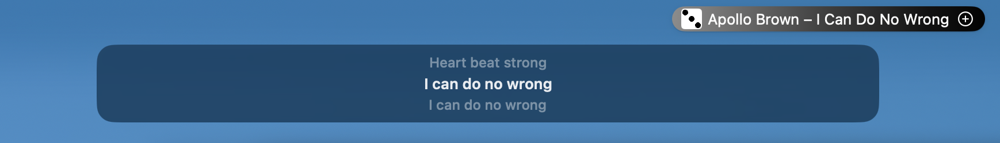
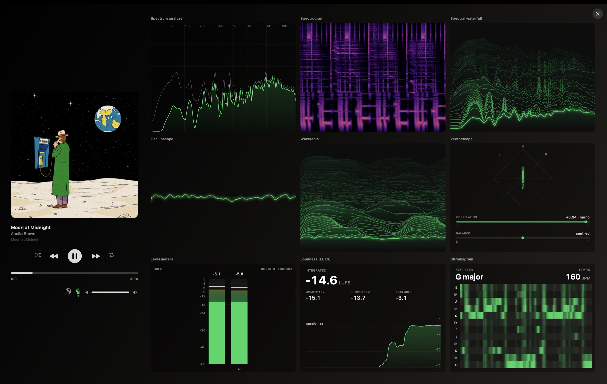

# Barsong

Spotify in your Mac's menu bar: the cover and the song up top, a one-click like, a player a click away, synced lyrics under the notch, and studio-style analysis of what you're hearing.

Barsong is an independent project, not affiliated with or endorsed by Spotify.



## Features

**Menu bar**
- The album cover and "Artist – Title" (or "Title – Artist", title only, or just the cover). A pause badge shows while paused.
- One click on **+** adds the song to Liked Songs; the check mark removes it.
- A lyrics button turns the floating lyrics on.
- Optional pill background, plain or tinted with the cover's colours.

**Player**
- Play/pause, previous, next, shuffle, repeat, a scrubber, and Spotify's own volume.
- Click the title or cover to open the song in Spotify, and the artist or album to open those.
- A copy button puts the song's open.spotify.com link on your clipboard.
- Full and compact (one-row) layouts, and a pin to keep the player open.
- Pick any accent colour, or keep Spotify green.

**Lyrics**
- Synced lyrics in a floating pill below the menu bar, showing 1, 2, 3 or 5 lines.
- Click a line to jump to it in the song.
- Expand to a full-height view of the whole song.
- Dark, light, glass or album-coloured styles.
- Drag them anywhere, and reset to a default position.
- The timing can be nudged earlier or later.
- Lyrics come from LRCLIB, with NetEase as a fallback.

**Visualizer**
- Studio-style analysis of Spotify's audio beside the player: spectrum, spectrogram, scopes, level and loudness meters, and key. See [Visualizers](#visualizers) below.

**General**
- Open at login.

## Visualizers



The visualizer column sits to the right of the full player. Switch visuals with the **‹ ›** arrows above it, by clicking the visual itself, or under Settings → Player.

- **Full screen:** hover the visual and click the expand button in its corner. It opens a full-screen view with the player on the left and every visual at once. Click a visual to show it large; **All visuals** goes back to the grid; Esc leaves full screen.
- **Pausing:** freezes the picture exactly as it was, so you can study it, and listening stops until you press play.
- **Requirements:** macOS 14.2 or later and the System Audio Recording permission (see [First run](#first-run)).

### How the data is collected

Every visual is drawn from the same audio and the same analysis pass.

- **Capture:** a Core Audio process tap (macOS 14.2+) on Spotify's own processes, mixed to stereo, inside a private aggregate device on your current output device. A tap means the system hands Barsong a copy of the audio those processes send to your output device: nothing is heard through a microphone, and no other app's sound is in the stream. Spotify plays on untouched, nothing else is tapped, and nothing is recorded or saved. Barsong listens only while a visual is on screen and the music plays; pausing removes the tap, and a new track restarts the loudness, key and tempo measurements, which take a few seconds to settle.
- **Every chunk of audio** (a few milliseconds, straight from the audio device): peak and RMS levels, the stereo scope's points, correlation and balance, and the loudness meter — K-weighted per sample to ITU-R BS.1770, in 100 ms hops (momentary 400 ms, short-term 3 s, gated integrated, one history point every 0.2 s).
- **From a Hann-windowed 4096-sample window** (~11.7 Hz per bin at 48 kHz): the spectrum curve (192 log-spaced bands over 20 Hz–20 kHz, tilted +3 dB per octave, rising fast and falling back gently), the waveform, triggered on a rising zero crossing of a low-passed copy, and the spectral flux the tempo is read from. Waveform snapshots are stacked 30 a second, spectra 20 a second.
- **Sixty times a second**, three windows at once — 16384, 8192 and 4096 samples: one spectrogram column of 512 log-spaced rows from 30 Hz to 16 kHz, each row read at the resolution meant for its frequency. The longest window also gives the note strengths, summing bins from 55 Hz to 2 kHz onto the 12 pitch classes, which feed the chromagram and, averaged over ~15 s, the key.
- **Tempo:** onset strength resampled onto a 100 Hz grid, autocorrelated over the last 8 seconds between 60 and 200 BPM, re-estimated twice a second.
- **It is Spotify's output** that gets measured, after Spotify's volume and **Normalize volume** settings — which is why the loudness meter asks for 100%.

### Where each visual comes from

Nine visuals, every one of them a reading of that same frame:

- **Spectrum analyzer** — the 192-band curve itself, with a peak line that holds and sinks slowly.
- **Spectrogram** — one 512-row column per 1/60 s, scrolled right to left; about 9 seconds fit across.
- **Spectral waterfall** — the analyzer curve saved 20 times a second, the last 48 of them stacked front to back (~2.4 s).
- **Oscilloscope** — the triggered 256-point waveform, blended with the previous frame so it glides.
- **Wavetable** — that same waveform saved 30 times a second, the last 60 stacked (~2 s).
- **Vectorscope** — 512 recent left/right sample pairs, scaled so the loudest sits near the edge, with the correlation and balance measured on every chunk.
- **Level meters** — the per-chunk peak and RMS in dBFS, with studio ballistics (24 dB/s fall, ~300 ms RMS, a 1.5 s peak hold).
- **Loudness (LUFS)** — the K-weighted 100 ms hops: momentary, short-term, the gated integrated value, and a minute of short-term history.
- **Chromagram** — the 12 note strengths, kept 15 times a second for ~8 seconds, with the key read from ~15 s of them and the tempo from the onset autocorrelation.

## Requirements

- macOS 13 or later. The visualizer needs macOS 14.2 or later.
- The Spotify desktop app.
- For Liked Songs and the artist and album links: a Spotify account that can create a developer app. Spotify currently requires Premium for that.

## Install

Barsong is built from source.

1. Install Xcode 16 or later, or just its command line tools:
   ```sh
   xcode-select --install
   ```
2. Clone and build:
   ```sh
   git clone https://github.com/asger3p/barsong.git
   cd barsong
   ./build.sh
   ```

`build.sh` builds the app, installs it to `~/Applications/Barsong.app` and opens it. Run it again to update.

## First run

macOS asks for two permissions:

- **"Barsong wants to control Spotify"**: needed to read the current song and cover, and to play, pause, skip, seek and change the volume. Barsong doesn't start Spotify on its own: it only launches it if you click the cover or title while nothing is playing.
- **System Audio Recording**: only asked when the visualizer first opens. It lets Barsong tap Spotify's own processes (see [How the data is collected](#how-the-data-is-collected)). Spotify keeps playing normally, no other app's audio is included, and nothing is recorded or saved.

Both can be changed later in macOS System Settings → Privacy & Security.

## Connect your Spotify account

Liked Songs and the artist and album links use the Spotify Web API. Each user signs in through a small Spotify app of their own, so there's no shared key and no user limit. Barsong walks you through it under Settings (gear icon) → **Spotify Account**:

1. **Create a Spotify app.** "Open Spotify dashboard" takes you to the form. Copy in the app name and the redirect URI (`http://127.0.0.1:43117/callback`) with the copy buttons, tick **Web API** and save. The account creating the app needs Spotify Premium.
2. **Paste its Client ID**, found under the app's Settings. Barsong connects as soon as a complete Client ID is pasted.
3. **Approve in the browser.** After that, Barsong keeps you signed in.

## Privacy

Barsong talks to four places, and only these:

- **[LRCLIB](https://lrclib.net)** (lyrics): the artist, title, album and length of the current song. If that finds no synced lyrics, a second request sends just the artist and title to its search endpoint. These requests identify themselves as `Barsong/1.0`.
- **NetEase** (fallback lyrics, only when LRCLIB has none): the artist and title as one search string, then the id of the matching song — no album, no length. These requests identify themselves as `Barsong/1.0` too.
- **Spotify's Web API** (Liked Songs, artist and album links): track, artist and album ids, with the token from your own developer app.
- **Spotify's image servers**: the cover, from whatever URL Spotify reports for the current track.

Everything else stays on your Mac:

- Settings and your Client ID are kept in the app's preferences, which are not encrypted.
- The Spotify refresh token is kept in your Keychain. Access tokens are held in memory only.
- Audio is analysed live in memory and never stored or sent anywhere.

## Troubleshooting

- **No cover, or the buttons do nothing:** allow Barsong under System Settings → Privacy & Security → Automation → Spotify.
- **The visualizer says "No sound coming through":** allow Barsong under System Settings → Privacy & Security → System Audio Recording, then reopen the player.
- **Connecting fails with "Couldn't listen on port 43117":** another program is using that port. Quit it and try again.
- **"Spotify API error 403":** check that **Web API** is ticked for your developer app.
- **No lyrics for a song:** neither LRCLIB nor NetEase has synced lyrics for it. The lyrics button shows a crossed-out mic when that's the case.

## Uninstall

Turn off **Open Barsong at login** first (or remove Barsong later under System Settings → General → Login Items), then:

```sh
rm -rf ~/Applications/Barsong.app
defaults delete dev.asger.Barsong
security delete-generic-password -s dev.asger.Barsong
```

## Acknowledgements

- [LRCLIB](https://lrclib.net) for synced lyrics.
- NetEase Cloud Music as a fallback lyrics source, an idea borrowed from [LyricFever](https://github.com/aviwad/LyricFever).

## License

MIT. See [LICENSE](LICENSE).
